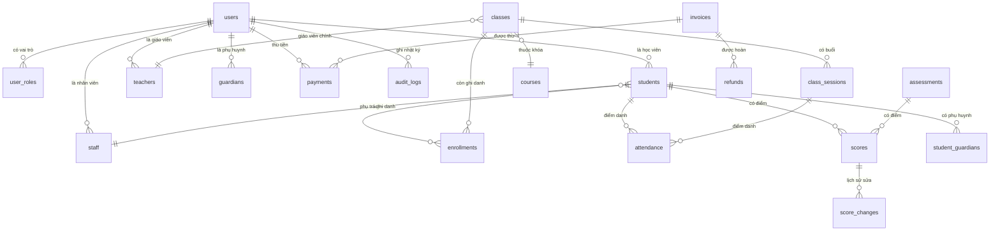

# Tài liệu cơ sở dữ liệu

> Cập nhật: 2026-10-06 — Phase 3 (P3)

## 1. Quy ước chung

| Vật thể | Quy ước |
|---|---|
| Tên bảng | `snake_case`, số nhiều (`students`, `class_sessions`) |
| Tên cột DB | `snake_case` |
| Tên trường Prisma / JSON API | `camelCase` |
| Khóa chính | `id` kiểu `SERIAL` (bigint tự tăng) |
| Tiền | Số nguyên `bigint`/`Int`, đơn vị VND. Không dùng số thực. |
| Thời gian | `timestamptz` (lưu UTC, hiển thị `Asia/Ho_Chi_Minh`). Ngày thuần: `date`. |
| Xóa mềm | `deleted_at` (`timestamptz`, null = còn dùng) cho hồ sơ người và nội dung. |
| Dòng chỉ thêm | Bảng nhật ký (`audit_logs`, `login_history`, `attendance_changes`, `score_changes`, `payments`) không có `updated_at`, `deleted_at`; trigger chặn UPDATE/DELETE. |
| Transaction | Thao tác nhiều bước chạy trong một transaction. |
| Audit | Ghi `audit_logs` cho tạo/sửa/xóa dữ liệu quan trọng. |
| Ràng buộc SQL | CHECK, UNIQUE có điều kiện, trigger, view viết bằng SQL trong migration. Prisma chỉ tạo bảng/cột/enum cơ bản. |

## 2. Cột chuẩn

Hầu hết bảng nghiệp vụ có:
- `id` — khóa chính tự tăng
- `created_at` — `timestamptz`, mặc định `now()`
- `updated_at` — `timestamptz`, cập nhật tự động bởi trigger
- `deleted_at` — `timestamptz`, null (chỉ bảng cần xóa mềm)
- `created_by`, `updated_by` — FK đến `users.id`

Bảng chỉ thêm không có `updated_at`, `deleted_at`.

## 3. Danh sách bảng

### 3.1. Tài khoản và bảo mật (A)

| Bảng | Mô tả |
|---|---|
| `users` | Tài khoản đăng nhập |
| `roles` | Danh mục vai trò |
| `user_roles` | Gán vai trò cho người dùng (1 người nhiều vai trò) |
| `permissions` | Quyền chi tiết (P2) |
| `role_permissions` | Vai trò có quyền nào (P2) |
| `login_history` | Lịch sử đăng nhập |
| `password_reset_tokens` | Token đặt lại mật khẩu |
| `refresh_tokens` | Token làm mới (P2) |
| `audit_logs` | Nhật ký thao tác |
| `sensitive_access_logs` | Log đọc dữ liệu nhạy cảm (P2) |

### 3.2. Cơ sở và cấu hình (B)

| Bảng | Mô tả |
|---|---|
| `branches` | Cơ sở/chi nhánh |
| `rooms` | Phòng học |
| `time_slots` | Ca học cố định (P1) |
| `settings` | Cấu hình hệ thống (key/value) |
| `files` | Tệp tải lên chung |
| `sequences` | Bộ đếm sinh mã |
| `attendance_lock_days` | Số ngày khóa điểm danh |

### 3.3. Con người (C)

| Bảng | Mô tả |
|---|---|
| `students` | Hồ sơ học viên |
| `guardians` | Phụ huynh/người giám hộ |
| `student_guardians` | Quan hệ HV - PH |
| `teachers` | Hồ sơ giáo viên |
| `staff` | Hồ sơ nhân viên |
| `student_assignments` | Lịch sử nhân viên phụ trách (P2) |
| `profile_change_requests` | Yêu cầu sửa hồ sơ (P2) |
| `student_notes` | Ghi chú chăm sóc (P2) |

### 3.4. Đào tạo (D)

| Bảng | Mô tả |
|---|---|
| `courses` | Khóa học (danh mục) |
| `course_lessons` | Giáo trình mẫu 64 bài (P2) |
| `course_price_history` | Lịch sử giá niêm yết (P2) |
| `classes` | Lớp học |
| `class_teachers` | Nhiều giáo viên/lớp (P2) |
| `class_schedules` | Quy tắc lịch lặp hằng tuần |
| `class_sessions` | Từng buổi học cụ thể |
| `enrollments` | Ghi danh học viên |
| `attendance` | Điểm danh |
| `attendance_changes` | Lịch sử sửa điểm danh (P2) |
| `enrollment_freezes` | Bảo lưu ghi danh (P2) |
| `makeup_sessions` | Buổi học bù (P2) |

### 3.5. Học tập (E)

| Bảng | Mô tả |
|---|---|
| `assessments` | Bài kiểm tra/đợt thi |
| `scores` | Điểm từng học viên |
| `score_changes` | Lịch sử sửa điểm (P2) |
| `assignments` | Bài tập |
| `student_feedback` | Nhận xét định kỳ (P2) |

### 3.6. Học phí (F)

| Bảng | Mô tả |
|---|---|
| `invoices` | Khoản phải thu |
| `invoice_items` | Chi tiết khoản thu |
| `installments` | Góp theo kỳ (P2) |
| `payments` | Phiếu thu — chỉ thêm |
| `refunds` | Hoàn phí |
| `discounts` | Mã giảm giá |
| `invoice_discounts` | Áp dụng giảm giá cho hoá đơn |
| `payment_adjustments` | Bút toán điều chỉnh thu |
| `daily_cash_closings` | Đối soát tiền mặt cuối ngày |

### 3.7. Lương (G)

| Bảng | Mô tả |
|---|---|
| `pay_rates` | Đơn giá theo buổi/giờ/tháng (P2) |
| `payroll_periods` | Kỳ tính lương |
| `payroll_items` | Chi tiết lương từng người |

### 3.8. Tuyển sinh (H)

| Bảng | Mô tả |
|---|---|
| `lead_sources` | Nguồn khách |
| `leads` | Khách tiềm năng |
| `lead_activities` | Lịch sử chăm sóc lead |

### 3.9. Lịch trình và thông báo (I)

| Bảng | Mô tả |
|---|---|
| `event_types` | Loại sự kiện |
| `events` | Sự kiện |
| `event_audiences` | Đối tượng nhận sự kiện |
| `notifications` | Thông báo hệ thống (P2) |
| `announcements` | Thông báo chung |

### 3.10. Nội dung website (J)

| Bảng | Mô tả |
|---|---|
| `post_categories` | Danh mục bài viết |
| `posts` | Bài viết/tin tức |
| `site_banners` | Banner trang chủ |
| `testimonials` | Đánh giá khách hàng |
| `gallery_items` | Ảnh thư viện |
| `site_contents` | Nội dung tĩnh landing |

### 3.11. Import và tệp (K)

| Bảng | Mô tả |
|---|---|
| `import_batches` | Lô nhập Excel |
| `import_rows` | Chi tiết từng dòng nhập |

## 4. Sơ đồ quan hệ (Mermaid)



## 5. Cách thêm migration và ràng buộc SQL

### 5.1. Migration thông thường (Prisma)

```bash
cd backend
npx prisma migrate dev --name <ten_thay_doi>
```

Prisma sẽ sinh SQL tương ứng với thay đổi trong `schema.prisma` (thêm bảng, cột, enum, index, FK).

### 5.2. Migration chỉ chứa SQL thủ công

Khi cần thêm CHECK, unique có điều kiện, trigger, view:

```bash
cd backend
npx prisma migrate dev --name <ten> --create-only
```

Sau đó sửa file `backend/prisma/migrations/<ngay>_<ten>/migration.sql` và thêm SQL tay.

**Lưu ý:**
- Không sửa migration đã áp dụng trên môi trường có dữ liệu thật.
- Luôn commit migration kèm với thay đổi `schema.prisma` trong cùng một commit.
- Đặt tên rõ ràng: `add_payments_append_only_trigger`, `create_v_invoice_balance_view`.

## 6. Danh sách view

| View | Mục đích | Cột chính |
|---|---|---|
| `v_invoice_balance` | Công nợ từng khoản thu | `invoice_id`, `total_amount`, `paid_amount`, `refunded_amount`, `remaining_amount`, `derived_status`, `days_overdue` |
| `v_enrollment_progress` | Tiến độ học từng lần ghi danh | `enrollment_id`, `total_sessions`, `sessions_held`, `sessions_attended`, `attendance_rate`, `progress_percent` |

Công thức tính nằm trong migration `constraints`. Backend chỉ đọc view, không lưu cột "còn nợ" hay "tiến độ" nhập tay.

## 7. Ràng buộc SQL đã áp dụng

### 7.1. CHECK

- Tiền: `payments.amount > 0`, `refunds.amount > 0`, `invoice_items.amount > 0`, ...
- Hoá đơn: `total_amount = subtotal_amount - discount_amount`
- Sĩ số/tổng buổi: `classes.max_students > 0`, `courses.total_sessions > 0`, ...
- Miền giá trị: `weekday BETWEEN 0 AND 6`, `rating BETWEEN 1 AND 5`, ...
- `enrollments.tuition_amount >= 0`

### 7.2. UNIQUE có điều kiện

- `enrollments`: mỗi học viên chỉ có 1 lần ghi danh `ACTIVE` trong cùng lớp (index `enrollments_active_unique`)

### 7.3. Trigger append-only

- `payments`: chặn UPDATE/DELETE (`payments_append_only`)
- `scores`: chặn UPDATE/DELETE (`scores_append_only`)
- `attendance_changes`, `score_changes`, `audit_logs`, `login_history`: chặn UPDATE/DELETE (`ttnn_append_only_table`)

### 7.4. Index tìm tiếng Việt không dấu

Hàm `ttnn_unaccent()` đánh dấu `IMMUTABLE` để dùng được trong index:
- `students (ttnn_unaccent(full_name))`
- `teachers (ttnn_unaccent(full_name))`
- `staff (ttnn_unaccent(full_name))`
- `leads (ttnn_unaccent(full_name))`
- `guardians (ttnn_unaccent(full_name))`

## 8. Lệnh thường dùng

```bash
# Tạo migration mới
cd backend && npx prisma migrate dev --name <ten>

# Dựng database từ migration (dev)
cd backend && npx prisma migrate dev

# Reset hoàn toàn database dev (xóa hết dữ liệu)
cd backend && npx prisma migrate reset

# Seed demo (không có dữ liệu thật)
cd backend && npx prisma db seed -- --demo

# Seed cơ bản (chỉ vai trò + admin + 1 khóa học)
cd backend && npx prisma db seed

# Xem trạng thái migration
cd backend && npx prisma migrate status
```
