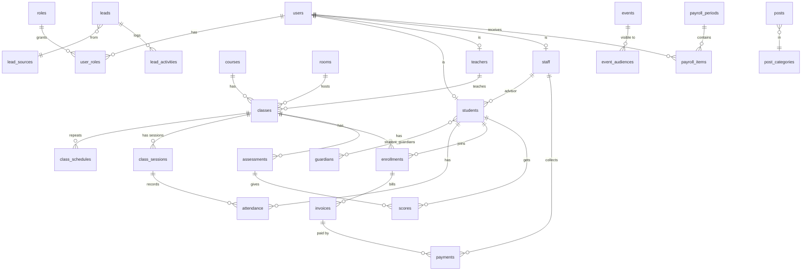

# Thiết kế database đầy đủ: Web quản lý trung tâm ngoại ngữ

Tài liệu này thay thế và mở rộng phần database trong file `quan-ly-trung-tam-ngoai-ngu.md`. Nó bao gồm:

1. Nguyên tắc và quy ước chung
2. **Cột chuẩn** nên có ở hầu hết các bảng
3. Toàn bộ bảng của dự án, chia theo nhóm và đánh mức ưu tiên
4. Cột nên thêm sớm vào các bảng lõi để sau này đỡ phải sửa
5. Các bảng cho tương lai (face ID, QR, thanh toán online, thông báo...)
6. Sơ đồ quan hệ, ràng buộc quan trọng, lộ trình migration

**Ký hiệu ưu tiên:** `P1` = làm ngay (MVP), `P2` = giai đoạn 2, `P3` = tương lai (nên thiết kế chừa chỗ, chưa cần tạo).

**Thay đổi so với bản trước:** bảng `sessions` (buổi học) được đổi tên thành **`class_sessions`** để không trùng với "phiên đăng nhập" (session) của hệ thống xác thực. Vai trò nên dùng `roles` + `user_roles` ngay từ đầu để một người có thể vừa là giáo viên vừa là nhân viên.

---

## 1. Quy ước chung

- Hệ quản trị: **PostgreSQL**.
- Tên bảng và cột: `snake_case`, tên bảng số nhiều (`students`), khóa ngoại dạng `student_id`.
- Khóa chính: `id` kiểu `bigint` tự tăng, hoặc `uuid` nếu sau này cần đồng bộ nhiều hệ thống. Chọn một kiểu và dùng thống nhất.
- Tiền: số nguyên VND (`bigint`), không dùng số thực.
- Thời gian: `timestamptz` (lưu UTC, hiển thị giờ Việt Nam). Ngày thuần dùng `date`.
- Trạng thái: dùng `enum` hoặc `text` kèm `CHECK`. Danh mục có thể thay đổi (loại sự kiện, nguồn lead, phương thức thanh toán) thì dùng **bảng tra cứu**.
- Dữ liệu linh hoạt chưa rõ cấu trúc: cột `metadata jsonb` (dùng tiết kiệm, không thay cho cột thật).
- Không bao giờ xóa cứng dữ liệu tiền, điểm danh, điểm số, hồ sơ học viên.

## 2. Cột chuẩn cho (hầu hết) mọi bảng

| Cột | Kiểu | Mục đích |
|---|---|---|
| `id` | bigint / uuid | Khóa chính |
| `created_at` | timestamptz, mặc định `now()` | Thời điểm tạo |
| `updated_at` | timestamptz | Thời điểm sửa gần nhất (cập nhật bằng trigger) |
| `created_by` | FK `users.id` | Ai tạo |
| `updated_by` | FK `users.id` | Ai sửa gần nhất |
| `deleted_at` | timestamptz, null | Xóa mềm (null = còn dùng) |
| `branch_id` | FK `branches.id` | Cơ sở (chỉ cần ở bảng nghiệp vụ; xem mục 4) |
| `row_version` | int | Tăng mỗi lần sửa, chống hai người sửa đè nhau |

Bảng **chỉ ghi thêm, không sửa** (nhật ký, thanh toán, lịch sử) không cần `updated_at`, `deleted_at`.

---

## 3. Danh sách bảng theo nhóm

### 3.1. Tài khoản, phân quyền, bảo mật

| Bảng | Ưu tiên | Mục đích | Cột chính |
|---|---|---|---|
| **users** | P1 | Tài khoản đăng nhập | username, email, phone, password_hash, status (active/locked/disabled), must_change_password, failed_login_count, locked_until, last_login_at, avatar_file_id |
| **roles** | P1 | Danh mục vai trò | code (`admin`, `staff`, `teacher`, `student`, `guardian`), name |
| **user_roles** | P1 | Một người nhiều vai trò | user_id, role_id, branch_id, granted_by, granted_at |
| **permissions** | P2 | Danh mục quyền chi tiết | code (ví dụ `payment.refund`, `student.delete`), mô tả |
| **role_permissions** | P2 | Vai trò có quyền nào | role_id, permission_id |
| **login_history** | P1 | Lịch sử đăng nhập | user_id, thời gian, IP, user_agent, kết quả (thành công/sai mật khẩu/bị khóa) |
| **password_reset_tokens** | P1 | Đặt lại mật khẩu | user_id, token_hash, expires_at, used_at |
| **audit_logs** | P1 | Nhật ký thao tác | user_id, action, table_name, record_id, old_data (jsonb), new_data (jsonb), ip, thời gian |
| **sensitive_access_logs** | P2 | Ai đã xem dữ liệu nhạy cảm (lương, dữ liệu sinh trắc) | user_id, loại dữ liệu, record_id, thời gian |

> Mật khẩu chỉ lưu `password_hash` (bcrypt/argon2). Mật khẩu tạm sinh khi import chỉ hiển thị một lần, có `must_change_password = true`.

### 3.2. Cơ sở và cấu hình

| Bảng | Ưu tiên | Mục đích | Cột chính |
|---|---|---|---|
| **branches** | P1 | Cơ sở/chi nhánh (tạo sẵn 1 dòng, chừa đường mở rộng) | name, address, phone, status |
| **rooms** | P1 | Phòng học | branch_id, name, capacity, status |
| **settings** | P1 | Cấu hình hệ thống | key, value (jsonb), mô tả. Ví dụ: số ngày khóa sửa điểm danh, thông tin trung tâm, mẫu biên lai |
| **files** | P1 | Quản lý tệp tải lên chung (ảnh, tài liệu, tệp import) | storage_key, tên gốc, mime_type, size, checksum, uploaded_by, owner_type, owner_id |
| **sequences** | P1 | Bộ đếm sinh mã không trùng (mã học viên, số biên lai, theo năm) | name, year, last_value |

### 3.3. Con người

| Bảng | Ưu tiên | Mục đích | Cột chính |
|---|---|---|---|
| **students** | P1 | Hồ sơ học viên | user_id (null nếu chưa có tài khoản), student_code (duy nhất), họ tên, ngày sinh, giới tính, phone, email, địa chỉ, trường/lớp đang học, nguồn biết đến trung tâm, `advisor_id` (nhân viên phụ trách), status (đang học/nghỉ/bảo lưu/đã tốt nghiệp), ghi chú |
| **guardians** | P1 | Phụ huynh / người giám hộ | họ tên, phone, email, nghề nghiệp, user_id (nếu cho đăng nhập sau này) |
| **student_guardians** | P1 | Học viên - phụ huynh (nhiều-nhiều: anh chị em chung phụ huynh) | student_id, guardian_id, quan hệ, is_primary, nhận thông báo/học phí (bool) |
| **teachers** | P1 | Hồ sơ giáo viên | user_id, teacher_code, họ tên, phone, email, chuyên môn, chứng chỉ, bio, ảnh, `show_on_website` (hiện trên landing), status |
| **staff** | P1 | Hồ sơ nhân viên | user_id, staff_code, họ tên, phone, email, chức vụ, ngày vào làm, status |
| **student_assignments** | P2 | Lịch sử nhân viên phụ trách học viên | student_id, staff_id, từ ngày, đến ngày, lý do chuyển giao |
| **profile_change_requests** | P2 | Học viên/nhân viên đề nghị sửa thông tin, chờ duyệt | user_id, bảng, trường, giá trị cũ, giá trị mới, status (chờ/duyệt/từ chối), reviewed_by |
| **teacher_qualifications** | P3 | Chứng chỉ giáo viên (IELTS, TESOL...) | teacher_id, tên, điểm/cấp, ngày cấp, ngày hết hạn, file_id |

### 3.4. Đào tạo

| Bảng | Ưu tiên | Mục đích | Cột chính |
|---|---|---|---|
| **courses** | P1 | Khóa học (danh mục) | code, name, level, language, mô tả, `total_sessions` (64), `sessions_per_week` (2), `duration_months` (8), học phí niêm yết hiện tại, tuổi tối thiểu/tối đa, slug, ảnh, `is_public`, status |
| **course_lessons** | P2 | Giáo trình mẫu: 64 bài của khóa | course_id, lesson_no (1-64), tiêu đề, nội dung/mục tiêu, tài liệu |
| **course_price_history** | P2 | Lịch sử giá niêm yết | course_id, giá, hiệu lực từ ngày, đến ngày |
| **classes** | P1 | Lớp học | branch_id, course_id, class_code, name, `teacher_id` (giáo viên chính), room_id mặc định, start_date, expected_end_date, max_students, status (dự kiến/đang học/kết thúc/hủy) |
| **class_teachers** | P2 | Lịch sử/nhiều giáo viên của lớp (đổi giáo viên giữa chừng, trợ giảng) | class_id, teacher_id, vai trò (chính/trợ giảng), từ ngày, đến ngày |
| **class_schedules** | P1 | Quy tắc lịch lặp hằng tuần | class_id, thứ (1-7), giờ bắt đầu, giờ kết thúc, room_id, hiệu lực từ/đến |
| **class_sessions** | P1 | Từng buổi học cụ thể (dùng để điểm danh) | class_id, `lesson_no` (buổi thứ mấy trong 64), ngày, giờ bắt đầu/kết thúc, room_id, teacher_id (người dạy thực tế), status (đã lên lịch/đã dạy/hủy/dạy bù), lý do hủy, `locked_at` (khóa sửa điểm danh) |
| **enrollments** | P1 | Ghi danh học viên vào lớp | student_id, class_id, ngày ghi danh, ngày bắt đầu học, `total_sessions` (chụp lại 64), `tuition_amount` (chụp lại học phí), status (đang học/bảo lưu/nghỉ/hoàn thành/chuyển lớp), lý do nghỉ, `transferred_from_enrollment_id` (nếu chuyển lớp), created_by |
| **attendance** | P1 | Điểm danh | class_session_id, student_id (hoặc enrollment_id), status (có mặt/vắng/muộn/có phép), ghi chú, `marked_by`, `marked_at`, **`method`** (manual/qr/face), `checked_in_at`. Ràng buộc duy nhất: (class_session_id, student_id) |
| **attendance_changes** | P2 | Lịch sử sửa điểm danh | attendance_id, trạng thái cũ, trạng thái mới, changed_by, thời gian, lý do |
| **enrollment_freezes** | P2 | Bảo lưu | enrollment_id, từ ngày, đến ngày dự kiến, lý do, approved_by |
| **makeup_sessions** | P2 | Học bù | student_id, class_session_id gốc (buổi vắng), class_session_id bù, status |
| **placement_tests** | P3 | Bài test xếp lớp đầu vào | lead_id/student_id, ngày, điểm, trình độ đề xuất, người chấm |

> **Tiến độ "đã học X/64 buổi"** tính từ số bản ghi `attendance` có mặt (hoặc số `class_sessions` đã dạy của lớp) chia cho `enrollments.total_sessions`. Không lưu sẵn con số này như một cột nhập tay, để khỏi lệch dữ liệu.

### 3.5. Học tập: điểm, bài tập, nhận xét

| Bảng | Ưu tiên | Mục đích | Cột chính |
|---|---|---|---|
| **assessments** | P2 | Bài kiểm tra/đợt thi của lớp | class_id, tên (giữa khóa, cuối khóa...), loại, ngày, điểm tối đa, hệ số, created_by |
| **scores** | P2 | Điểm từng học viên | assessment_id, student_id, điểm, nhận xét, entered_by, entered_at. Ràng buộc duy nhất (assessment_id, student_id) |
| **score_changes** | P3 | Lịch sử sửa điểm | score_id, điểm cũ/mới, changed_by, lý do |
| **assignments** | P2 | Bài tập (giai đoạn đầu chỉ là thông báo) | class_id, tiêu đề, mô tả, hạn nộp, created_by, file_id đính kèm |
| **assignment_submissions** | P3 | Học viên nộp bài online (làm sau nếu cần) | assignment_id, student_id, file_id, nộp lúc, điểm, nhận xét giáo viên, status |
| **student_feedback** | P2 | Nhận xét định kỳ của giáo viên về học viên | student_id, class_id, kỳ, nội dung, teacher_id, hiển thị cho phụ huynh (bool) |
| **learning_materials** | P3 | Tài liệu học tập | class_id/course_id, tiêu đề, file_id, người đăng |

### 3.6. Học phí, thu chi

| Bảng | Ưu tiên | Mục đích | Cột chính |
|---|---|---|---|
| **invoices** | P1 | Khoản phải thu | invoice_no, enrollment_id, tổng gốc, giảm giá, **tổng phải đóng**, hạn đóng, status (chưa đóng/một phần/đã đóng/quá hạn/hủy), created_by |
| **invoice_items** | P2 | Các dòng của khoản thu (học phí, giáo trình, phí thi...) | invoice_id, mô tả, số tiền, loại |
| **installments** | P2 | Chia đợt đóng | invoice_id, đợt thứ, số tiền, hạn đóng |
| **payments** | P1 | Mỗi lần thu tiền (**chỉ thêm, không sửa, không xóa**) | receipt_no (duy nhất), invoice_id, số tiền (> 0), ngày thu, phương thức (tiền mặt/chuyển khoản/thẻ), mã giao dịch ngân hàng, `collected_by`, ghi chú |
| **refunds** | P2 | Hoàn phí (bút toán riêng) | payment_id/invoice_id, số tiền, lý do, requested_by, **approved_by**, ngày hoàn |
| **discounts** | P2 | Danh mục giảm giá/học bổng | name, loại (% hoặc số tiền), điều kiện, hiệu lực |
| **invoice_discounts** | P2 | Giảm giá áp vào khoản thu nào | invoice_id, discount_id, số tiền giảm, approved_by |
| **payment_adjustments** | P2 | Điều chỉnh khi nhập sai (thay vì sửa/xóa payment) | payment_id, loại, số tiền, lý do, tạo bởi |
| **daily_cash_closings** | P2 | Chốt thu tiền cuối ngày theo nhân viên | staff_id, ngày, tổng hệ thống, tổng thực nhận, chênh lệch, người xác nhận |
| **payment_transactions** | P3 | Giao dịch thanh toán online/ngân hàng chưa đối soát | nhà cung cấp, mã giao dịch, số tiền, nội dung chuyển khoản, trạng thái, payment_id (khi khớp), raw (jsonb) |

> **Công nợ** = tổng phải đóng của invoice − tổng payments (và điều chỉnh/hoàn phí). Nên tạo `VIEW` để tính, không lưu cột "còn nợ" nhập tay.

### 3.7. Lương nhân sự

| Bảng | Ưu tiên | Mục đích | Cột chính |
|---|---|---|---|
| **pay_rates** | P2 | Lịch sử mức lương/đơn giá | user_id (hoặc teacher_id/staff_id), kiểu (theo buổi/theo giờ/cố định tháng), số tiền, hiệu lực từ ngày, đến ngày |
| **payroll_periods** | P2 | Kỳ lương theo tháng | tháng/năm, status (nháp/**đã chốt**/đã trả), locked_by, locked_at |
| **payroll_items** | P2 | Dòng lương từng người trong kỳ | payroll_period_id, user_id, số buổi/giờ dạy, đơn giá chụp lại, lương cơ bản, thưởng, phạt, phụ cấp, tổng, ghi chú, status |
| **payroll_item_details** | P3 | Chi tiết buổi dạy được tính lương | payroll_item_id, class_session_id, số tiền |

> Nhân viên/giáo viên chỉ xem `payroll_items` của chính mình khi `payroll_periods.status` là "đã chốt" (và ghi `sensitive_access_logs`).

### 3.8. Tuyển sinh

| Bảng | Ưu tiên | Mục đích | Cột chính |
|---|---|---|---|
| **lead_sources** | P1 | Danh mục nguồn (website, Facebook, giới thiệu, tờ rơi...) | name |
| **leads** | P1 | Khách tiềm năng | họ tên, phone, email, course_id quan tâm, source_id, utm (jsonb), status (mới/đã gọi/hẹn học thử/đã chốt/không chốt), lý do không chốt, `assigned_to` (nhân viên), `converted_student_id`, ghi chú, thời gian đăng ký |
| **lead_activities** | P2 | Lịch sử chăm sóc (cuộc gọi, tin nhắn, hẹn) | lead_id, loại, nội dung, staff_id, thời gian, lịch hẹn kế tiếp |
| **trial_bookings** | P3 | Đặt lịch học thử | lead_id, class_session_id, status |

### 3.9. Lịch trình và thông báo

| Bảng | Ưu tiên | Mục đích | Cột chính |
|---|---|---|---|
| **event_types** | P1 | Loại sự kiện + màu hiển thị (nghỉ lễ, thi, khai giảng, sự kiện) | name, color |
| **events** | P1 | Lịch trình (thêm/sửa/xóa) | title, event_type_id, bắt đầu, kết thúc, cả ngày (bool), mô tả, địa điểm, created_by, updated_by, deleted_at |
| **event_audiences** | P1 | Ai nhìn thấy sự kiện | event_id, audience_type (`all`/`class`/`role`/`user`), ref_id (class_id, role_id hoặc user_id) |
| **notifications** | P2 | Thông báo trong hệ thống (chuông) | user_id, tiêu đề, nội dung, loại, link, read_at, created_at |
| **announcements** | P2 | Thông báo chung gửi theo đối tượng | tiêu đề, nội dung, đối tượng, created_by |
| **notification_templates** | P3 | Mẫu tin nhắn (nhắc lịch, nhắc học phí) | code, kênh (email/sms/zalo), nội dung có biến |
| **notification_logs** | P3 | Nhật ký gửi tin ra ngoài | user/guardian, kênh, mẫu, trạng thái gửi, lỗi, thời gian |

### 3.10. Nội dung website (landing page)

| Bảng | Ưu tiên | Mục đích | Cột chính |
|---|---|---|---|
| **post_categories** | P1 | Chuyên mục bài đăng | name, slug |
| **posts** | P1 | Bài đăng hiển thị trên web | title, slug (duy nhất), summary, content, cover_file_id, category_id, status (nháp/chờ duyệt/đã đăng), **facebook_url** (tùy chọn), published_at, author_id, approved_by, seo_title, seo_description |
| **site_banners** | P1 | Banner trang chủ | title, ảnh, link, thứ tự, hiển thị từ/đến |
| **testimonials** | P2 | Cảm nhận học viên | tên, nội dung, ảnh, khóa học, hiển thị (bool) — chỉ đăng khi có sự đồng ý |
| **gallery_items** | P2 | Thư viện ảnh | file_id, chú thích, album, thứ tự |
| **site_contents** | P2 | Nội dung chỉnh được của trang (giới thiệu, FAQ, liên hệ) | key, nội dung (jsonb), updated_by |

> Khóa học và giáo viên hiển thị ở landing page lấy từ `courses` và `teachers` (cột `is_public`, `show_on_website`), không cần bảng riêng.

### 3.11. Import Excel

| Bảng | Ưu tiên | Mục đích | Cột chính |
|---|---|---|---|
| **import_batches** | P1 | Mỗi lần import | loại (học viên/giáo viên/nhân viên), file_id, status (đã tải/đã xem trước/đã xác nhận/hoàn tất/hủy), tổng dòng, số dòng lỗi, created_by |
| **import_rows** | P1 | Từng dòng của file | batch_id, số dòng, dữ liệu gốc (jsonb), status (hợp lệ/lỗi/đã tạo), thông báo lỗi, record_id được tạo |

> Quy trình: tải file → lưu `import_rows` ở trạng thái chờ → hiển thị lỗi từng dòng → admin xác nhận → tạo tài khoản trong một transaction. Mật khẩu tạm không lưu ở `import_rows`.

---

## 4. Cột nên thêm sớm vào bảng lõi (để về sau khỏi sửa lớn)

| Bảng | Cột nên thêm | Vì sao |
|---|---|---|
| **tất cả bảng nghiệp vụ** | `branch_id` | Mở thêm cơ sở mà không phải đập đi làm lại |
| **students** | `student_code`, `advisor_id`, `source_id`, `status`, `deleted_at` | Mã nhìn được; phân công; thống kê nguồn tuyển sinh |
| **students** | `photo_file_id` | Dùng cho thẻ học viên, và nhận diện nếu sau này làm face ID (xem mục 5) |
| **courses** | `total_sessions`, `sessions_per_week`, `duration_months`, `slug`, `is_public` | Lộ trình 64 buổi/8 tháng nằm trong dữ liệu, không nằm cứng trong code |
| **enrollments** | `total_sessions`, `tuition_amount` (chụp lại), `start_date`, `expected_end_date`, `status` | Đổi giá/lộ trình khóa học không làm sai hồ sơ cũ |
| **class_sessions** | `lesson_no`, `locked_at`, `teacher_id` thực dạy | Theo dõi buổi thứ mấy trên 64; khóa sửa điểm danh; tính lương đúng người dạy |
| **attendance** | `method`, `checked_in_at`, `marked_by`, `source_device_id` (null) | Chừa chỗ cho QR/face ID mà không phải sửa bảng |
| **invoices** | `invoice_no`, `discount_amount`, `due_date`, `status` | Công nợ và nhắc phí |
| **payments** | `receipt_no` (duy nhất), `collected_by`, `reference_code`, `method` | Đối soát; chuyển khoản online tự khớp sau này |
| **users** | `must_change_password`, `failed_login_count`, `locked_until`, `last_login_at` | Bảo mật đăng nhập |
| **posts** | `facebook_url`, `status`, `slug`, `approved_by` | Link Facebook, quy trình duyệt, SEO |
| **events** | `deleted_at`, `updated_by` + bảng `event_audiences` | Nhật ký ai sửa; đối tượng nhận linh hoạt |
| **guardians** | `user_id` (null) | Cho phụ huynh đăng nhập sau này |

**Ràng buộc nên có ngay:**
- `students.student_code`, `teachers.teacher_code`, `payments.receipt_no`, `invoices.invoice_no`, `posts.slug`, `courses.code`, `classes.class_code`: `UNIQUE`.
- `attendance (class_session_id, student_id)`, `scores (assessment_id, student_id)`, `enrollments (student_id, class_id)` (kèm điều kiện còn hiệu lực): `UNIQUE`.
- `payments.amount > 0`, `classes.max_students > 0`, `courses.total_sessions > 0`: `CHECK`.
- Khóa ngoại cho mọi quan hệ; `ON DELETE RESTRICT` với dữ liệu tiền và điểm danh.
- Index: các khóa ngoại, `students.phone`, `leads.phone`, `class_sessions (class_id, ngày)`, `payments.paid_at`, `invoices.status`, `audit_logs (table_name, record_id)`.

---

## 5. Bảng cho tương lai: điểm danh QR và Face ID

### 5.1. Điểm danh bằng mã QR (P3)

| Bảng | Cột chính |
|---|---|
| **devices** | Thiết bị điểm danh (máy tính bảng ở cửa lớp, camera): name, loại, room_id, secret_hash, status, last_seen_at |
| **attendance_qr_tokens** | Mã QR theo buổi/học viên: class_session_id (hoặc student_id), token_hash, expires_at, used_at |

Chỉ cần thêm hai bảng này vì bảng `attendance` đã có `method`, `checked_in_at`, `source_device_id`.

### 5.2. Face ID (P3)

Face ID dùng **dữ liệu sinh trắc học**, thuộc nhóm dữ liệu cá nhân nhạy cảm. Với học viên là trẻ em còn cần sự đồng ý của phụ huynh. Vì vậy phải thiết kế theo hướng: **có đồng ý rõ ràng, tách riêng, mã hóa, có thể thu hồi, có nhật ký**.

| Bảng | Mục đích | Cột chính |
|---|---|---|
| **biometric_consents** | Sự đồng ý | student_id, guardian_id (nếu dưới 18 tuổi), phiên bản chính sách đã đọc, consent_at, `revoked_at`, bằng chứng (file_id bản ký/ghi nhận), người ghi nhận |
| **face_templates** | Dữ liệu khuôn mặt dạng vector (embedding), **không lưu ảnh gốc nếu không cần** | student_id, embedding (**mã hóa**), model_name, model_version, chất lượng, created_at, `revoked_at`, `delete_after` |
| **face_recognition_logs** | Mỗi lần nhận diện | device_id, class_session_id, student_id khớp (null nếu không khớp), độ tin cậy, kết quả (khớp/không khớp/cần duyệt), thời gian. **Không lưu ảnh chụp** hoặc đặt thời gian tự xóa ngắn |
| **face_review_queue** | Trường hợp độ tin cậy thấp cần giáo viên xác nhận tay | log_id, reviewed_by, quyết định |

Lưu ý thiết kế:
- Chỉ điểm danh bằng face ID khi có dòng `biometric_consents` còn hiệu lực. Thu hồi đồng ý thì xóa/vô hiệu `face_templates` tương ứng.
- Embedding gắn với `model_version`: đổi mô hình nhận diện sẽ phải tính lại, nên cần cột này.
- Giới hạn quyền đọc các bảng này chặt hơn các bảng khác (tài khoản riêng, hoặc cột mã hóa), ghi `sensitive_access_logs` mỗi khi truy cập.
- Luôn giữ phương án dự phòng (điểm danh tay/QR) vì nhận diện có thể sai, và học viên không đồng ý vẫn phải được điểm danh bình thường.
- Quy định pháp lý về dữ liệu cá nhân (Nghị định 13/2023/NĐ-CP và các văn bản mới hơn về bảo vệ dữ liệu cá nhân) có thể đã thay đổi; trước khi triển khai nên kiểm tra văn bản hiện hành hoặc hỏi người am hiểu pháp lý về việc xin đồng ý, đánh giá tác động và thời hạn lưu trữ.

### 5.3. Các hướng mở rộng khác

| Hướng | Bảng/cột sẽ cần |
|---|---|
| Thanh toán online, đối soát tự động | `payment_transactions` (mục 3.6), webhook ngân hàng |
| Gửi Zalo/SMS/email | `notification_templates`, `notification_logs`, bảng liên kết tài khoản Zalo (`external_accounts`: user_id, nhà cung cấp, external_id) |
| Đăng bài tự động lên Fanpage | `social_accounts` (token mã hóa, hết hạn), `post_publications` (post_id, nền tảng, id bài ngoài, trạng thái, lỗi) |
| Cổng phụ huynh | `guardians.user_id`, vai trò `guardian` ở `roles`, quyền xem theo `student_guardians` |
| Chứng chỉ/giấy chứng nhận hoàn thành | `certificates` (enrollment_id, số chứng chỉ, ngày cấp, file_id), `certificate_templates` |
| Nộp bài online | `assignment_submissions` (mục 3.5) |
| Đánh giá giáo viên/khảo sát | `surveys`, `survey_responses` |
| Nhiều cơ sở | `branches` đã có, thêm `branch_id` vào bảng nghiệp vụ, quyền theo cơ sở ở `user_roles` |
| Báo cáo nhanh | Bảng tổng hợp/materialized view: `report_monthly_revenue`, `report_attendance_rate`... |

---

## 6. Sơ đồ quan hệ

### 6.1. Dạng văn bản

```
users 1─n user_roles n─1 roles n─n permissions
users 1─1 students | teachers | staff | guardians   (qua user_id)

students n─n guardians                      (student_guardians)
students n─1 staff                          (advisor_id)

courses 1─n course_lessons
courses 1─n classes
classes 1─n class_schedules
classes 1─n class_sessions 1─n attendance n─1 students
classes 1─n class_teachers n─1 teachers
classes 1─n enrollments n─1 students
classes 1─n assessments 1─n scores n─1 students
classes 1─n assignments

enrollments 1─n invoices 1─n invoice_items
invoices 1─n installments
invoices 1─n payments 1─n refunds
invoices n─n discounts                      (invoice_discounts)
payments n─1 staff                          (collected_by)

payroll_periods 1─n payroll_items n─1 users
users 1─n pay_rates

leads 1─n lead_activities
leads n─1 lead_sources
leads 1─1 students                          (converted_student_id)

events n─1 event_types
events 1─n event_audiences

posts n─1 post_categories
import_batches 1─n import_rows

(tương lai)
students 1─n biometric_consents
students 1─n face_templates
devices 1─n face_recognition_logs n─1 class_sessions
```

### 6.2. Sơ đồ Mermaid (dán vào trình xem hỗ trợ Mermaid để thấy hình)



---

## 7. Lộ trình tạo bảng (migration)

| Đợt | Nội dung | Bảng |
|---|---|---|
| **1. Nền tảng** | Tài khoản, phân quyền, cơ sở, tệp, nhật ký | users, roles, user_roles, login_history, password_reset_tokens, audit_logs, branches, rooms, settings, files, sequences |
| **2. Cốt lõi đào tạo** | Con người, khóa học, lớp, ghi danh, điểm danh | students, guardians, student_guardians, teachers, staff, courses, classes, class_schedules, class_sessions, enrollments, attendance |
| **3. Học phí** | Khoản thu, thu tiền | invoices, payments (+ view công nợ) |
| **4. Vận hành** | Lịch trình, tuyển sinh, bài đăng, import | event_types, events, event_audiences, lead_sources, leads, post_categories, posts, site_banners, import_batches, import_rows |
| **5. Học tập và lương** | Điểm, bài tập, thông báo, lương | assessments, scores, assignments, student_feedback, notifications, announcements, pay_rates, payroll_periods, payroll_items |
| **6. Nâng cao** | Hoàn phí, chia đợt, bảo lưu, học bù, quyền chi tiết | refunds, discounts, installments, enrollment_freezes, makeup_sessions, permissions, role_permissions, lead_activities, ... |
| **7. Tương lai** | QR, Face ID, thanh toán online, thông báo ngoài | devices, attendance_qr_tokens, biometric_consents, face_templates, face_recognition_logs, payment_transactions, notification_logs, ... |

Mỗi đợt là một nhóm file migration đánh số, lưu cùng mã nguồn, không sửa trực tiếp trên database thật.

## 8. Tóm tắt các quyết định thiết kế quan trọng

1. **Chụp lại (snapshot)** học phí, số buổi, đơn giá lương tại thời điểm giao dịch.
2. **Tiền chỉ ghi thêm**: payments không sửa, không xóa; sai thì điều chỉnh/hoàn phí bằng dòng mới.
3. **Tách quy tắc và thực thể**: `class_schedules` (quy tắc lịch) và `class_sessions` (buổi thật); `invoices` và `payments`.
4. **Tiến độ, công nợ tính ra** từ dữ liệu gốc (view), không nhập tay.
5. **Vai trò nhiều-nhiều** (`user_roles`) để một người đảm nhiều việc.
6. **Sự kiện có đối tượng nhận** (`event_audiences`) để học viên chỉ thấy lịch của mình.
7. **Lương có kỳ và trạng thái chốt**, chỉ hiện cho người nhận sau khi chốt, có nhật ký truy cập.
8. **Import qua bảng tạm** có xem trước và báo lỗi từng dòng.
9. **Dữ liệu sinh trắc học** tách riêng, có đồng ý, mã hóa, thu hồi được, có nhật ký.
10. **Chừa sẵn** `branch_id`, `method`, `source_device_id`, `metadata` để mở rộng không cần đập cấu trúc cũ.

## 9. Bước tiếp theo

1. Chốt danh sách bảng đợt 1 đến 4 (MVP).
2. Viết **SQL PostgreSQL** (hoặc migration cho Supabase/ORM bạn chọn) cho các đợt đó.
3. Viết **dữ liệu mẫu** để kiểm tra giao diện và truy vấn công nợ, tiến độ 64 buổi.
4. Thiết lập **sao lưu tự động** và thử khôi phục trước khi nhập dữ liệu thật.
